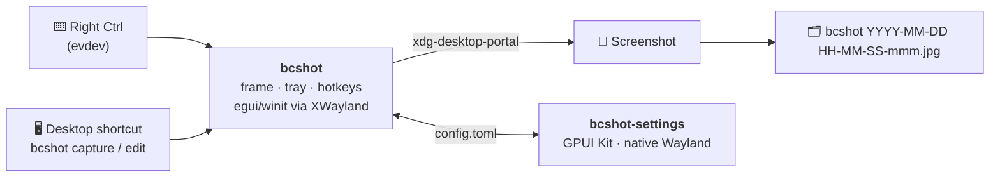

<div align="center">

# 📸 bcshot

**Fixed-rectangle screenshots for Linux. One key, one area, saved straight to a folder.**

Set the frame once, then tap **Right Ctrl** whenever you want a capture. No dialogs, no cropping, no clicks.

[](https://github.com/argyris-mpalampanisb/bcshot/actions/workflows/ci.yml)
[](LICENSE)


[Features](#-features) •
[Install](#-install) •
[Usage](#-usage) •
[Configuration](#%EF%B8%8F-configuration) •
[How it works](#-how-it-works) •
[Troubleshooting](#-troubleshooting)

</div>

---

## ✨ Features

- 🎯 **Fixed capture area.** Place a frame on screen once. Every capture uses exactly that rectangle.
- ⌨️ **Single-key capture.** Tap **Right Ctrl** on its own, or any key you pick. Combos like Ctrl+C keep working normally.
- 🔇 **Silent and lossless by default.** No shutter sound, JPEG quality 100.
- 🗂️ **Timestamped files.** Saved as `bcshot 2026-10-28 20-08-18-261.jpg` to the folder you choose.
- 🖼️ **Notification preview.** A thumbnail with *Open* and *Show in folder* after each capture. A new capture replaces the old notification, so rapid captures don't pile up. Turn it off in Settings → **Notification**; failed captures are still reported.
- 🧭 **Tray icon.** Capture, adjust the frame, open the folder and open Settings from the tray.
- 🎨 **Settings window.** Dark theme with a live preview of the last capture. Native Wayland, sharp at fractional scaling.
- 🔁 **Live config.** Both apps watch the config file, so changes apply immediately.

If you're coming from Bandicam's *Rectangle on a screen* mode on Windows, this will feel familiar.

> [!NOTE]
> Tested on **Fedora with KDE Plasma 6.8 (Wayland)**. GNOME and X11 sessions should work but have had less real-world testing. [Bug reports](https://github.com/argyris-mpalampanisb/bcshot/issues) are welcome!

## 📦 Install

### Option A: prebuilt binary

1. Download `bcshot-linux-x86_64.tar.gz` from the [**latest release**](https://github.com/argyris-mpalampanisb/bcshot/releases/latest).
2. Extract it and run the installer:
   ```bash
   tar -xzf bcshot-linux-x86_64.tar.gz
   cd bcshot && ./install.sh
   ```

You still need the runtime libraries (Vulkan drivers, PipeWire, D-Bus), which most desktop installs already have. Development builds from `main` are under [Actions](https://github.com/argyris-mpalampanisb/bcshot/actions).

### Option B: build from source

<details>
<summary><b>1. Install build dependencies</b> (Fedora / Debian / Arch)</summary>

**Fedora**
```bash
sudo dnf install gcc clang pkgconf-pkg-config libxcb-devel libxkbcommon-devel libxkbcommon-x11-devel \
     wayland-devel vulkan-loader-devel pipewire-devel dbus-devel fontconfig-devel freetype-devel \
     openssl-devel mesa-libEGL-devel mesa-libgbm-devel
```

**Debian / Ubuntu**
```bash
sudo apt install build-essential clang pkg-config libxcb1-dev libxkbcommon-dev libxkbcommon-x11-dev \
     libwayland-dev libvulkan-dev libpipewire-0.3-dev libdbus-1-dev libfontconfig-dev libfreetype-dev \
     libssl-dev libegl1-mesa-dev libgbm-dev
```

**Arch**
```bash
sudo pacman -S base-devel clang libxcb libxkbcommon libxkbcommon-x11 wayland vulkan-icd-loader \
     pipewire dbus fontconfig freetype2 openssl mesa
```

</details>

**2. Build and install**

```bash
rustup update stable     # GPUI Kit needs the latest stable Rust
git clone https://github.com/argyris-mpalampanisb/bcshot.git
cd bcshot
./install.sh
```

`install.sh` installs everything for your user only, with no root needed:

| What | Where |
|---|---|
| `bcshot`, `bcshot-settings` | `~/.local/bin/` |
| App menu entry | `~/.local/share/applications/bcshot-settings.desktop` |
| Start at login | `~/.config/autostart/bcshot.desktop` |

### 3. Allow the capture key (one-time)

The single-key capture reads the keyboard directly, because desktop shortcuts can't bind a lone modifier key. Add yourself to the `input` group, then **log out and back in** (or reboot):

```bash
sudo usermod -aG input $USER
```

> [!WARNING]
> Membership in the `input` group lets any program you run read key presses. If you'd rather not grant that, set the capture key to **Off** and use a [desktop shortcut](#desktop-shortcuts) instead.

> [!TIP]
> The settings window renders with Vulkan. If it won't open, check that `vulkaninfo` lists your GPU.

## 🚀 Usage

### First run

1. Open **bcshot** from your app menu.
2. The frame starts **unlocked**. Move and resize it over the area you want to capture.
3. Press **Enter** to lock it. It's saved and stays put until you choose to adjust it again.
4. Tap **Right Ctrl**. Your screenshot is in the output folder. 🎉

### Capture key

| Action | Result |
|---|---|
| Tap **Right Ctrl** alone | 📸 Capture |
| **Right Ctrl + another key** (e.g. Ctrl+C) | Normal shortcut, no capture |
| Hold **Right Ctrl** for over 1 second | No capture |

Change the key, or turn it off, in **Settings → Hotkeys**.

### Adjusting the frame

| Input | Action |
|---|---|
| Drag inside the frame | Move |
| Drag an edge or corner | Resize |
| Drag outside the frame | Draw a new frame |
| <kbd>←</kbd> <kbd>↑</kbd> <kbd>→</kbd> <kbd>↓</kbd> | Nudge 1 px |
| <kbd>Shift</kbd> + arrows | Nudge 10 px |
| <kbd>Ctrl</kbd> + arrows | Resize |
| <kbd>Enter</kbd> or double-click | Lock |
| <kbd>Esc</kbd> | Cancel |

### Desktop shortcuts

bcshot also has commands you can bind to any key combo. No plug-in is needed: the desktop catches the key and runs the command.

| Command | What it does |
|---|---|
| `bcshot capture` | Take a screenshot of the frame area |
| `bcshot edit` | Unlock the frame to adjust it, or lock it again |

- **KDE:** System Settings → Keyboard → Shortcuts → *Add New* → *Command or Script*
- **GNOME:** Settings → Keyboard → *Custom Shortcuts*

### Tray icon

The menu has **Capture now**, **Adjust / Lock frame**, **Show frame**, **Open folder**, **Settings…** and **Quit**. Left-clicking the icon opens Settings.

- **KDE** shows it out of the box. Look under the **^** overflow arrow if it's hidden.
- **GNOME** needs the [AppIndicator and KStatusNotifierItem Support](https://extensions.gnome.org/extension/615/appindicator-support/) extension.

## ⚙️ Configuration

Everything can be changed in the Settings window: output folder (with a **Browse…** picker), file prefix, format and JPEG quality, shutter sound, frame and capture key.

Settings are stored in plain TOML at:

```
~/.config/bcshot/config.toml
```

Both apps watch this file, so edits made by hand or in the Settings window take effect immediately.

## 🧩 How it works

bcshot is two programs that share one config file:



| | Role | Built with |
|---|---|---|
| **`bcshot`** | Background app with the on-screen frame, tray icon, notifications and capture key. Starts at login. | egui / winit (via XWayland) |
| **`bcshot-settings`** | Settings window with a live preview of the last capture. | [GPUI Kit](https://crates.io/crates/gpui-kit) (native Wayland) |

<details>
<summary><b>Why two toolkits?</b></summary>

The frame must be transparent, always on top and click-through. GPUI can't do all three on GNOME or KDE Wayland yet, so the frame uses winit through XWayland, where all three work. The settings window has no such needs, so it runs GPUI natively on Wayland and stays sharp at 125% and 150% scaling.

</details>

## 🛠️ Troubleshooting

<details>
<summary><b>"Cannot find required wayland protocol" when tapping quickly</b></summary>

Fixed in v0.2.1, so update if you still see it. Each capture takes about a second through the screenshot portal, and older versions ran overlapping captures at once, which the portal can't handle. Captures now queue up, so every tap is saved. When you tap faster than about once a second, each screenshot is taken when its turn comes, not at the exact moment you tapped.

</details>

<details>
<summary><b>Tapping Right Ctrl does nothing</b></summary>

Check that you're in the `input` group: `id -nG` should list `input`. If it doesn't, run `sudo usermod -aG input $USER`, then log out and back in. Also check that the key isn't set to **Off** in Settings → Hotkeys.

</details>

<details>
<summary><b>The screen flashes, or I'm asked for permission on every capture</b></summary>

On Wayland, captures go through xdg-desktop-portal, and some portal versions ask for permission or flash the screen on every capture. A ScreenCast/PipeWire backend that asks only once fixes this.

</details>

<details>
<summary><b>I can't find the tray icon</b></summary>

On KDE, open the **^** overflow arrow in the system tray. On GNOME, install the AppIndicator extension linked [above](#tray-icon).

</details>

<details>
<summary><b>The frame is on the wrong monitor</b></summary>

The frame overlay currently assumes the primary monitor. Multi-monitor support is not implemented yet.

</details>

## 🧰 Extras

**`scripts/override_file_dates.sh`** sets every file in a folder (default `~/Pictures/Ultimate_Deck`) to *created now / modified now*. It's a port of a Windows PowerShell helper. Linux can't set a file's creation time directly, so on BTRFS each file is replaced by an instant `cp --reflink` copy, which takes no extra disk space. Run `./scripts/override_file_dates.sh -h` for the options.

## 🗑️ Uninstall

```bash
pkill -x bcshot
rm ~/.local/bin/bcshot ~/.local/bin/bcshot-settings \
   ~/.local/share/applications/bcshot-settings.desktop \
   ~/.config/autostart/bcshot.desktop
rm -r ~/.config/bcshot   # optional: also remove your settings
```

## 📄 License

[MIT](LICENSE) © argyris-mpalampanisb
